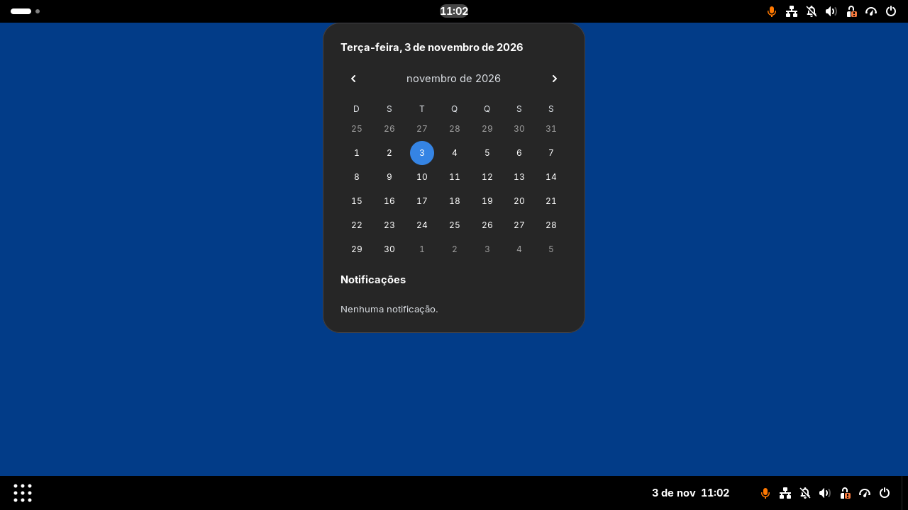
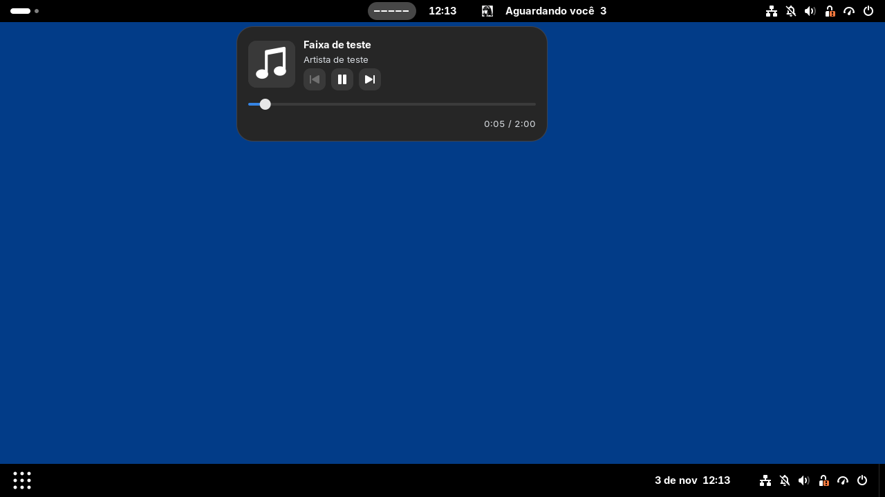
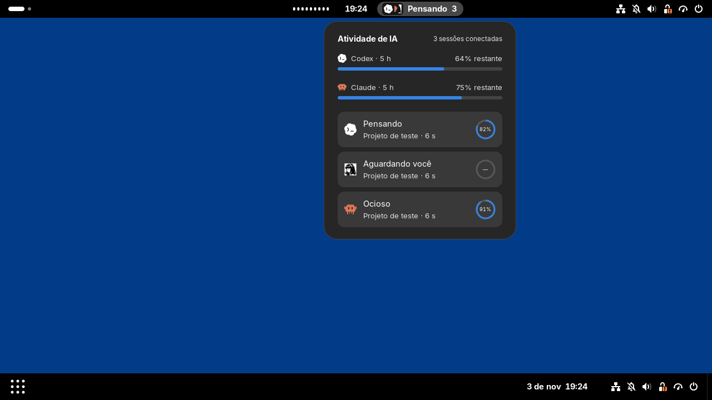

# QuietClock

Extensão para **GNOME Shell 50** que reúne relógio, música e atividade de assistentes de IA na barra superior.

O relógio fica centralizado, com calendário e notificações. O módulo de música oferece controles de reprodução, capa, progresso e visualizador de áudio. As integrações com Codex, Claude Code e Hermes exibem sessões, estado e duração das tarefas, com indicadores de cota e contexto para Codex e Claude. Sem música ou sessões conectadas, fica só o relógio.

Capturas do protótipo com música e sessões de IA de demonstração:

